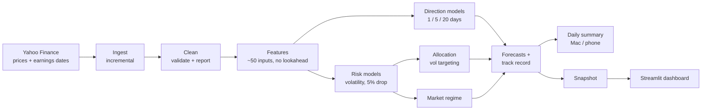

# Stock Market Predictor

[](https://github.com/Chrish1603/Stock-Market-Predictor/actions/workflows/pipeline.yml)


[](https://chrish-patel-stock-market-predictor.streamlit.app/)

An end-to-end machine-learning system for US stocks: it downloads and cleans market data, builds features without
lookahead, trains and compares models with walk-forward testing, turns the forecasts into position sizes, and
runs itself every trading day with a public dashboard and track record.

It started as an attempt to predict whether stocks go up or down. Rigorous testing showed that was close to a coin
flip, so the project shifted to what *is* forecastable: **risk**. It now forecasts each stock's volatility and
chance of a 5% drop, labels the market calm, normal or stressed, and sizes positions to keep risk steady.

**[Open the live dashboard →](https://chrish-patel-stock-market-predictor.streamlit.app/)** (updated each US trading day)

<picture>
  <source media="(prefers-color-scheme: dark)" srcset="docs/images/today-dark.png">
  
</picture>

> Educational project, not financial advice.

## Results

All out of sample, each with confidence intervals; see [docs/RESULTS.md](docs/RESULTS.md).

| Question | Answer |
|---|---|
| Can up/down direction be predicted? | Barely. The best models score ROC-AUC 0.52 against a coin flip's 0.50: statistically clear, practically tiny. Extra inputs and a pooled 63-stock model made no detectable difference. |
| Can volatility be predicted? | Yes. Forecasts beat "same as last month" (R² +0.31) and the standard HAR model (+0.05), p < 0.001, and held up on S&P 500 data back to 1997. Earnings dates help (p = 0.03). |
| Can the chance of a big drop be predicted? | A little. Calibrated probabilities beat quoting the historical drop rate (p = 0.02). |
| Does volatility targeting help? | It cuts drawdowns, not risk-adjusted return. Over 2013–2026 it halved the 4-stock portfolio's worst drawdown (−37.5% → −17.8%); it softened 2008 and COVID a lot but the slow 2000–02 decline only a little. Its Sharpe ratio isn't clearly better than buy-and-hold (p = 0.38). |
| Does a better forecast give better sizing? | No. Sizing with last month's volatility did as well as sizing with the model's forecast, so the simpler rule is the default. |

## What it does



- **Data:** adjusted daily prices for 4 tracked tickers (AAPL, MSFT, NVDA, SPY), a 59-stock training universe and
  market series (VIX), plus earnings dates. Downloads are incremental, and stored history is refetched when splits
  or dividends re-adjust it. A cleaning step validates every bar and reports what it fixed.
- **Features:** about 50 inputs per stock per day: returns, moving averages, volatility measures, market
  context, earnings timing, ranks across the universe and calendar effects, all using only data up to that day.
- **Direction models:** baseline, logistic/ridge, LightGBM and XGBoost for 1, 5 and 20 days ahead, chosen by
  walk-forward cross-validation, per stock or pooled across the universe.
- **Risk models:** volatility over the next 5 and 20 days (against persistence and HAR baselines) and the chance
  of a 5% drop, calibrated, with out-of-fold predictions saved for honest evaluation.
- **Allocation and regime:** a suggested holding per stock that targets 15% volatility, backtested out of
  sample with costs; and a calm / normal / stressed market label from forecast volatility, breadth and trend.
- **Outputs:** a daily summary, a Streamlit dashboard and a live track record that scores every forecast once
  its outcome is known.

## How results are tested

Most of the work went into making the results trustworthy:

- **No lookahead.** Features at day *t* only use data up to *t*'s close (tested). Today's unfinished price bar
  is ignored, earnings dates are only "known" 20 business days ahead, and an earnings surprise only from the
  day the market could react to it.
- **Walk-forward splits** in time order, with gaps at least as long as the forecast horizon, purged rows before
  the hold-out year, and scaling fitted inside each fold.
- **Baselines everywhere.** Every model is compared with a naive alternative; backtests charge costs and are
  compared with buy-and-hold.
- **Confidence intervals, not averages.** `smp experiment` trains config variants side by side and compares
  them period by period, with a cluster bootstrap over time periods (scores from the same period move together),
  a block bootstrap for daily returns, and Holm correction so trying many variants doesn't manufacture a winner.
- **Longer history.** `smp long-history` rebuilds the S&P 500 risk models from 1993 to test them through the
  2000–02 and 2008 crashes, which the main 2010+ data misses.
- **Calibration.** The dashboard plots forecasts against outcomes, so you can see that volatility forecasts sit
  close to what happened (about 2 points low) and where drop chances are overconfident.
- **A live record.** Every forecast is saved before its outcome exists and scored afterwards against the same
  simple alternatives, so results can't have been tuned to what happened.

An experiment is a YAML file in [experiments/](experiments/) listing variants as overrides to the config:

```yaml
name: direction_inputs
kind: direction                 # direction | risk | allocation
metric: classifier.roc_auc
control: default
compare_models: [baseline]      # also test the chosen model against these
variants:
  default: {}
  plus_rates: {data: {market_tickers: [SPY, ^VIX, ^TNX, ^IRX]}}
```

## Dashboard

| Tab | What it shows |
|---|---|
| **Today** | Market regime, and per stock: recent trend, volatility forecast vs its own history, chance of a 5% drop, suggested holding and a plain-English summary |
| **Risk & allocation** | Risk forecasts, forecast vs realised volatility, calibration, the allocation backtest, past crashes and the regime history |
| **Price & indicators** | Candlesticks with moving averages, earnings days and the expected price range over the next 20 days; RSI and MACD on request |
| **Direction models** | Up/down and return models per horizon: metrics vs baseline, ROC curve, what each model relies on, hold-out backtest |
| **Track record** | Every live forecast and how it turned out, against the simple alternatives |
| **Data quality** | What the cleaning step fixed or flagged |

| Volatility forecast vs what happened | Volatility targeting vs buy-and-hold |
|---|---|
|  |  |

## Running it every day

GitHub Actions lints and tests every push, and after each US close runs the whole pipeline and publishes a small
data snapshot that the hosted dashboard reads. The same pipeline also runs on a Mac on a schedule and sends a
summary to the desktop and phone.

Because it runs unattended, it's built to fail visibly and never lose its history: a failed stage doesn't stop
the others and is reported in the summary; the run fails (and GitHub emails) if data is out of date; the track
record is append-only and backed up, and a run or publish that would drop recorded predictions is refused. The
GitHub run keeps the official record, and local runs merge it in before adding their own.

## What I learned

- **Evaluation is the hard part, not modelling.** Most of the work went into closing leaks: overlapping multi-day
  labels, split-adjusted prices changing under stored data, today's unfinished price bar, earnings dates "known"
  too far ahead, and interest-rate levels that let trees memorise eras.
- **When direction failed, risk worked.** After many variations the up/down models stayed near a coin flip, so the
  project pivoted to volatility, which is persistent and genuinely forecastable.
- **Informal comparisons misled me twice.** A higher Sharpe ratio and a better pooled-model hold-out year both
  looked like wins. Proper confidence intervals showed both were noise.
- **Probabilities need calibration.** A gradient-boosted "big drop" model ranked risk well but was overconfident.
  A simple formula driven by the volatility forecast, then calibrated, beat it.
- **A better forecast isn't always a better decision,** and **the test period shapes the story:** "vol
  targeting halves drawdowns" held from 2010 on but not in the slow 2000–02 bear market.
- **Running daily is its own engineering problem.** Dropped schedules, stale caches and a restore step that could
  have wiped the history only showed up once the system ran on its own.

## Limitations

- The four tracked stocks are today's winners, which flatters buy-and-hold; the training universe has the same
  survivorship bias.
- The backtest assumes cash earns nothing and trades at the close the signal was computed from; Sharpe ratios
  aren't measured above the risk-free rate.
- Price ranges run slightly narrow (big moves are more common than a bell curve allows), and the regime label
  switches in and out of "stressed" often.
- US stocks in US dollars, free Yahoo Finance data, prices and earnings dates only. The live record is young.

## Quick start

Requires Python 3.10+. On macOS, LightGBM and XGBoost need OpenMP: `brew install libomp`.

```bash
python3 -m venv .venv && source .venv/bin/activate
pip install -e ".[dev]"
smp run-all                      # download, clean, build features, train, predict, summarise (~5 min)
streamlit run app/dashboard.py   # open the dashboard
```

```bash
smp run-all --skip-train         # refresh data and forecasts with the existing models
smp ingest | clean | features | train | sync | predict | notify    # one stage
smp track-record                 # how past live forecasts turned out
smp health                       # is the data current? (exit code 1 if not)
smp experiment run experiments/risk_vol_models.yaml         # compare config variants
smp long-history                 # S&P 500 risk models from 1993, tested through past crashes
smp publish --out site-data      # build the dashboard snapshot
pytest && ruff check .           # tests and lint
```

Settings live in [config/config.yaml](config/config.yaml): tickers, the training universe, horizons, optional
inputs, risk targets, costs, notifications and the snapshot URL.

<details>
<summary><b>Results in detail</b></summary>

**Volatility forecasts** (walk-forward CV R² on log annualised realised volatility; higher is better):

| Ticker | Horizon | Chosen model | R² | HAR baseline | "Same as last month" |
|---|---|---|---|---|---|
| SPY | 5d | ridge | **0.42** | 0.26 | 0.09 |
| SPY | 20d | ridge | **0.15** | 0.13 | −0.20 |
| AAPL | 5d | ridge | **0.17** | 0.07 | −0.12 |
| MSFT | 5d | ridge | **0.16** | 0.09 | −0.14 |
| NVDA | 5d | lightgbm | **0.09** | 0.02 | −0.16 |

Single stocks are harder than the index because of earnings jumps. Where no drop model beats the historical drop
rate, the dashboard shows the historical rate and says so.

**Allocation, 2013–2026 out of sample** (15% volatility target, no leverage, 0.1% cost per unit traded):

| 4-stock equal weight | CAGR | Volatility | Sharpe | Max drawdown |
|---|---|---|---|---|
| Buy & hold | 33.9% | 24.5% | 1.31 | −37.5% |
| Vol target, trailing vol (default) | 18.5% | 12.8% | 1.40 | **−17.8%** |
| Vol target, model forecast | 17.7% | 13.3% | 1.29 | −22.8% |
| Model forecast + drop filter | 16.4% | 12.6% | 1.27 | −22.6% |

Vol targeting holds about a third in cash on average, giving up return in a strong bull market in exchange for
half the drawdown.

**Through past crashes** (S&P 500 only, out of sample from 1997; [long_history](experiments/reports/long_history.md)):

| Crisis | Buy & hold | Vol target, trailing vol | Average holding |
|---|---|---|---|
| Dot-com bust, 2000–02 | −46% | −41% | 72% |
| Financial crisis, 2007–09 | −53% | −32% | 62% |
| COVID crash, 2020 | −28% | −16% | 50% |
| 2022 bear market | −23% | −18% | 68% |
| Whole period, 1997–2026: CAGR / max drawdown | 9.6% / −55% | 8.0% / −44% | 85% |

**Market regime** (S&P 500, out of sample; what happened over the next 20 trading days):

| Regime | Share of days | Volatility | Chance of a 5% drop | Average return |
|---|---|---|---|---|
| Calm | 26% | 10% | 8% | +0.6% |
| Normal | 60% | 14% | 13% | +1.0% |
| Stressed | 14% | 24% | 24% | +3.0% |

The labels separate risk well, but returns were higher after stressed days (rebounds): a risk signal, not a sell
signal.

**Direction models:** see [direction_inputs](experiments/reports/direction_inputs.md) and
[direction_scope](experiments/reports/direction_scope.md).

</details>

<details>
<summary><b>Setting up the daily runs</b></summary>

**GitHub Actions:** [.github/workflows/pipeline.yml](.github/workflows/pipeline.yml) runs after each US close
(or via *Run workflow*). GitHub's scheduler can drop runs, so there are three slots (22:30, 01:30 and 04:30 UTC);
later ones exit early once the day is published. Before publishing, it checks that no previously published
prediction has gone missing (`smp publish --previous`).

**Locally (macOS):** [scripts/install_schedule.sh](scripts/install_schedule.sh) installs a launchd job that runs
`smp run-all` at 11:00 Tue–Sat local time (just after the US close from New Zealand). Set `HOUR`, `MINUTE` and
`DAYS` for your time zone. Failures raise a desktop notification; logs go to `~/Library/Logs/smp/`.

```bash
scripts/install_schedule.sh
launchctl kickstart gui/$(id -u)/com.smp.pipeline     # run it once now to check
```

macOS blocks background jobs from reading `~/Documents`, `~/Desktop` and `~/Downloads`; keep the project
elsewhere or give `/bin/bash` Full Disk Access. Local runs merge in the official track record before predicting
(`dashboard.sync_track_record: false` turns this off).

**Hosted dashboard (Streamlit Community Cloud):** create an app from this repo, branch `main`, file
`app/dashboard.py`, Python 3.10. With no local pipeline output it downloads the latest snapshot from the
`dashboard-data` branch. Theme changes need *Manage app → Reboot app*.

**Daily summary:** written to `logs/summary.md`; optionally a Mac notification (`notify.macos`) and a phone push
via [ntfy](https://ntfy.sh) (`notify.ntfy_topic`, or an `NTFY_TOPIC` repository secret). ntfy topics are public
to anyone who knows the name, so treat it like a password.

</details>

<details>
<summary><b>Code layout</b></summary>

| Stage | Module | Output |
|---|---|---|
| Ingest | `smp.ingest` | Adjusted daily prices and earnings dates, fetched incrementally |
| Clean | `smp.clean` | Validated prices plus a quality report |
| Features | `smp.features` | Inputs and targets per horizon, no lookahead |
| Train | `smp.train`, `smp.pooled` | Direction models chosen by walk-forward CV, per stock or pooled |
| Risk | `smp.risk` | Volatility and calibrated 5%-drop models, with out-of-fold predictions |
| Allocation | `smp.allocation` | Volatility-targeted sizing and its backtest |
| Regime | `smp.regime` | Calm / normal / stressed market label |
| Sync | `smp.sync` | Local runs adopt the official track record |
| Predict | `smp.predict`, `smp.history`, `smp.risk_history` | Latest forecasts and the scored track records |
| Notify, publish | `smp.notify`, `smp.publish` | Daily summary; dashboard snapshot |
| Experiments | `smp.experiment`, `smp.stats`, `smp.long_history` | Variant comparisons and the 1993–2026 check |
| Dashboard numbers | `smp.insights` | Price ranges, calibration, rolling volatility |

```
config/config.yaml        settings
src/smp/                  pipeline package (one module per stage, plus cli, stats, experiment)
app/dashboard.py          Streamlit dashboard          .streamlit/   theme
experiments/              experiment specs and reports  docs/         results page and images
scripts/                  launchd job and runner        .github/      CI and the daily run
tests/                    pytest suite (pipeline, leakage, statistics, track records, dashboard)
```

</details>
