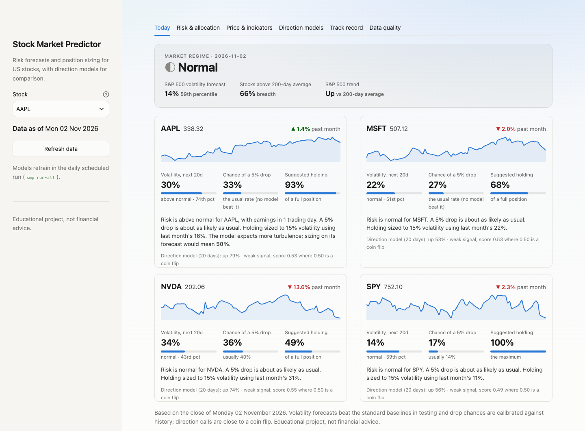
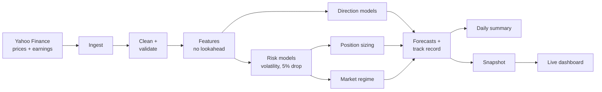
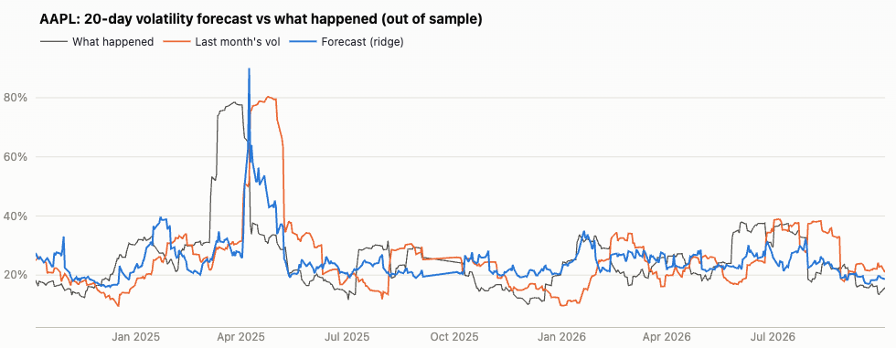
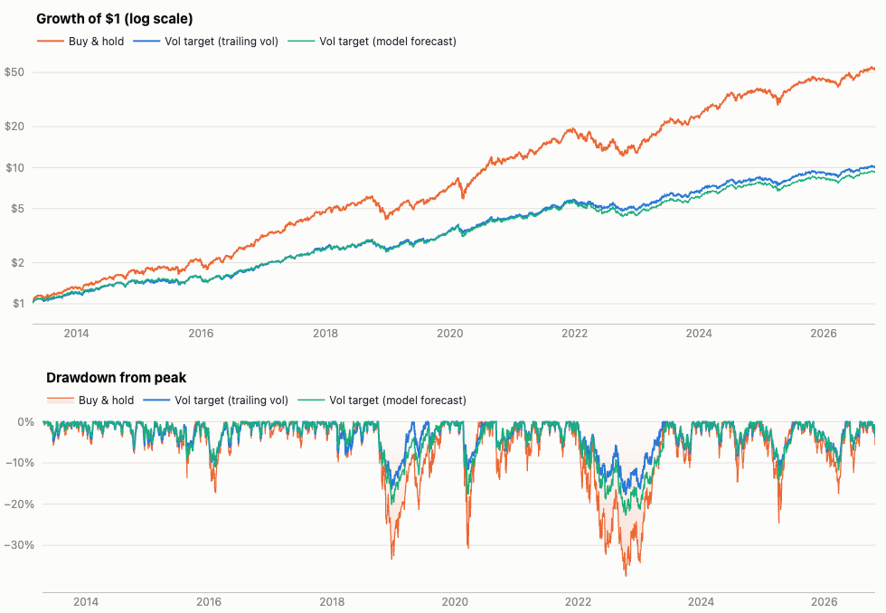

# Stock Market Predictor

[](https://github.com/Chrish1603/Stock-Market-Predictor/actions/workflows/pipeline.yml)


[](https://chrish-patel-stock-market-predictor.streamlit.app/)

An end-to-end machine-learning system for US stocks: it downloads and cleans market data, builds features without
lookahead, trains and compares models with walk-forward testing, turns the forecasts into position sizes, and
runs itself every trading day with a public dashboard and track record.

It started as an attempt to predict whether stocks go up or down. Rigorous testing showed that was close to a coin
flip, so the project shifted to what *is* forecastable: **risk**. It now forecasts each stock's volatility and
chance of a 5% drop, labels the market calm, normal or stressed, and sizes positions to keep risk steady.

**[Open the live dashboard →](https://chrish-patel-stock-market-predictor.streamlit.app/)** (updated each US trading day)

<picture>
  <source media="(prefers-color-scheme: dark)" srcset="docs/images/today-dark.png">
  
</picture>

> Educational project, not financial advice.

## Key results

All out of sample, with confidence intervals ([full results](docs/RESULTS.md)).

| Question | Finding |
|---|---|
| Can up/down direction be predicted? | **Barely.** Best ROC-AUC 0.52 vs 0.50 for a coin flip: statistically detectable, practically useless. |
| Can volatility be predicted? | **Yes.** Beats "same as last month" by +0.31 R² and the standard HAR model by +0.05 (p < 0.001), and held up on S&P 500 data back to 1997. |
| Does volatility targeting help an investor? | **It cuts drawdowns, not risk-adjusted return.** Worst drawdown −37.5% → −17.8% (2013–2026); 2008 −55% → −34%. Sharpe not significantly better (p = 0.38). |
| Is a better forecast a better decision? | **Not here.** Sizing on last month's volatility did as well as sizing on the model's forecast. |

## What this project demonstrates

- **Rigorous ML evaluation.** Walk-forward validation with purged gaps, no-lookahead features (tested), naive
  baselines for every model, and an experiment framework that compares variants with cluster-bootstrap
  confidence intervals and Holm correction. Two "wins" that looked real turned out to be noise.
- **Modelling and quantitative finance.** Gradient boosting (LightGBM, XGBoost) and linear models; volatility
  forecasting against the HAR benchmark; calibrated drop probabilities; volatility-targeted position sizing with
  transaction costs; a market regime indicator; a 30-year stress test through the 2000–02 and 2008 crashes.
- **Data engineering.** Incremental ingestion of 64 tickers plus earnings dates, a validation step that repairs
  or flags bad bars, and handling of the subtle problems: split-adjusted history changing under stored data,
  today's unfinished price bar, earnings dates "known" too early.
- **Production and MLOps.** A daily GitHub Actions pipeline with retry slots, health checks that fail loudly, a
  published data snapshot for the hosted app, and an append-only track record that refuses any run or publish
  that would lose a recorded prediction.
- **Communication.** A Streamlit dashboard that explains risk in plain words and dollars (expected price
  ranges), shows calibration so viewers can judge the forecasts, and states its limits. Daily summaries go to
  phone and desktop.
- **Software quality.** A typed, validated config, a CLI, about 100 tests (pipeline, leakage, statistics,
  dashboard), linting and CI on every push.

## Tech stack

Python · pandas · NumPy · scikit-learn · LightGBM · XGBoost · Plotly · Streamlit · pydantic · Typer · pytest ·
Ruff · GitHub Actions · Streamlit Community Cloud · Yahoo Finance data

## Architecture



One Python package with a module per stage and a CLI (`smp`), driven by a single config file. The same
pipeline runs in GitHub Actions and on a local schedule.

## Challenges and what I learned

- **Evaluation was harder than modelling.** Most of the effort went into finding leaks: overlapping multi-day
  labels, re-adjusted prices, the unfinished trading day, and interest-rate levels that let tree models memorise
  eras rather than learn patterns.
- **Accepting a negative result.** Direction stayed near a coin flip through many variations. Pivoting to
  volatility, which is persistent and genuinely forecastable, made the project useful.
- **Statistics over impressions.** A higher Sharpe ratio and a better hold-out year both looked like wins until
  confidence intervals showed they were noise. Every claim here now links to a report.
- **The test period shapes the story.** "Vol targeting halves drawdowns" held from 2010 on, but not in the slow
  2000–02 bear market, which only showed up after extending the data back to 1993.
- **Running daily is its own problem.** Dropped schedules, a stale cache serving old prices beside new
  forecasts, and a restore step that could have wiped the history only surfaced once it ran unattended.

## Limitations and next steps

**Limitations:** the four tracked stocks (AAPL, MSFT, NVDA, SPY) are today's winners, which flatters
buy-and-hold; the backtest assumes cash earns nothing and doesn't measure Sharpe above the risk-free rate; price
ranges run slightly narrow; the live track record only started in late 2026.

**Next steps:** a more realistic backtest (interest on cash, excess-return Sharpe); a live paper portfolio that
follows the suggested holdings; sizing the whole portfolio rather than each stock; testing on stocks not chosen
with hindsight; a steadier regime label.

## Run it yourself

Requires Python 3.10+ (on macOS, `brew install libomp` for LightGBM and XGBoost).

```bash
python3 -m venv .venv && source .venv/bin/activate
pip install -e ".[dev]"
smp run-all                      # download, clean, build features, train, predict (~5 min)
streamlit run app/dashboard.py   # open the dashboard
pytest && ruff check .           # tests and lint
```

Other commands: `smp track-record` (how live forecasts turned out), `smp experiment run <spec>` (compare
variants), `smp long-history` (the 1993–2026 stress test), `smp health` (is the data current?). Settings live in
[config/config.yaml](config/config.yaml).

<details>
<summary><b>Detailed results</b></summary>

**Volatility forecasts** (walk-forward CV R² on log annualised realised volatility; higher is better):

| Ticker | Horizon | Chosen model | R² | HAR baseline | "Same as last month" |
|---|---|---|---|---|---|
| SPY | 5d | ridge | **0.42** | 0.26 | 0.09 |
| SPY | 20d | ridge | **0.15** | 0.13 | −0.20 |
| AAPL | 5d | ridge | **0.17** | 0.07 | −0.12 |
| MSFT | 5d | ridge | **0.16** | 0.09 | −0.14 |
| NVDA | 5d | lightgbm | **0.09** | 0.02 | −0.16 |

**Allocation, 2013–2026 out of sample** (15% volatility target, no leverage, 0.1% cost per unit traded):

| 4-stock equal weight | CAGR | Volatility | Sharpe | Max drawdown |
|---|---|---|---|---|
| Buy & hold | 33.9% | 24.5% | 1.31 | −37.5% |
| Vol target, trailing vol (default) | 18.5% | 12.8% | 1.40 | **−17.8%** |
| Vol target, model forecast | 17.7% | 13.3% | 1.29 | −22.8% |
| Model forecast + drop filter | 16.4% | 12.6% | 1.27 | −22.6% |

**Through past crashes** (S&P 500 only, out of sample from 1997; [long_history](experiments/reports/long_history.md)):

| Crisis | Buy & hold | Vol target | Average holding |
|---|---|---|---|
| Dot-com bust, 2000–02 | −46% | −41% | 72% |
| Financial crisis, 2007–09 | −53% | −32% | 62% |
| COVID crash, 2020 | −28% | −16% | 50% |
| 2022 bear market | −23% | −18% | 68% |

**Market regime** (S&P 500, out of sample; what happened over the next 20 trading days):

| Regime | Share of days | Volatility | Chance of a 5% drop | Average return |
|---|---|---|---|---|
| Calm | 26% | 10% | 8% | +0.6% |
| Normal | 60% | 14% | 13% | +1.0% |
| Stressed | 14% | 24% | 24% | +3.0% |

The regime separates risk well, but returns were higher after stressed days (rebounds): a risk signal, not a
sell signal.

| Volatility forecast vs what happened | Volatility targeting vs buy-and-hold |
|---|---|
|  |  |

</details>

<details>
<summary><b>How results are tested</b></summary>

- **No lookahead:** features at day *t* use only data up to *t*'s close (`tests/test_features.py`); today's
  unfinished bar is ignored; earnings dates count as known only 20 business days ahead.
- **Walk-forward splits** in time order, with gaps at least as long as the horizon, a purged hold-out year and
  scaling fitted inside each fold.
- **Experiments:** each YAML file in [experiments/](experiments/) lists config variants. Each variant trains in its
  own folder; scores are paired by stock, horizon and period; 95% intervals come from a cluster bootstrap over time
  periods (or a block bootstrap for daily returns); p-values are Holm-corrected.
- **Calibration:** the dashboard plots grouped forecasts against outcomes. Volatility forecasts run about 2 points
  low; 65% and 93% of 20-day moves stayed inside the "typical" and "wide" price ranges (68% and 95% expected).
- **Live track record:** every forecast is saved before its outcome exists and scored afterwards, using the same
  definitions as training (`tests/test_risk_history.py`).

```yaml
name: direction_inputs
kind: direction                 # direction | risk | allocation
metric: classifier.roc_auc
control: default
compare_models: [baseline]      # also test the chosen model against these
variants:
  default: {}
  plus_rates: {data: {market_tickers: [SPY, ^VIX, ^TNX, ^IRX]}}
```

</details>

<details>
<summary><b>Dashboard tabs</b></summary>

| Tab | What it shows |
|---|---|
| **Today** | Market regime, and per stock: trend, volatility forecast vs its own history, chance of a 5% drop, suggested holding, plain-English summary |
| **Risk & allocation** | Risk forecasts, forecast vs realised volatility, calibration, the allocation backtest, past crashes, regime history |
| **Price & indicators** | Candlesticks, moving averages, earnings days and the expected price range over the next 20 days |
| **Direction models** | Metrics vs baseline, ROC curve, feature importance and hold-out backtest per horizon |
| **Track record** | Every live forecast and how it turned out |
| **Data quality** | What the cleaning step fixed or flagged |

</details>

<details>
<summary><b>Running it automatically</b></summary>

- **GitHub Actions** ([pipeline.yml](.github/workflows/pipeline.yml)): lints and tests every push; after each US
  close runs the pipeline and publishes the snapshot to the `dashboard-data` branch. Three schedule slots cover
  GitHub dropping runs; a run fails (and GitHub emails) if data is still stale, and publishing is refused if any
  previously published prediction would be lost.
- **macOS** ([install_schedule.sh](scripts/install_schedule.sh)): a launchd job runs `smp run-all` after the US
  close, merging in the official track record first. Keep the project outside `~/Documents`, `~/Desktop` and
  `~/Downloads`, which macOS blocks for background jobs.
- **Hosted dashboard:** Streamlit Community Cloud, file `app/dashboard.py`; with no local data it reads the latest
  snapshot. Theme changes need *Manage app → Reboot app*.
- **Notifications:** summary in `logs/summary.md`, optional Mac notification and phone push via
  [ntfy](https://ntfy.sh) (`notify.ntfy_topic`; treat the topic name like a password).

</details>

<details>
<summary><b>Code layout</b></summary>

```
config/config.yaml        settings
src/smp/                  pipeline package: ingest, clean, features, train, risk, allocation, regime,
                          predict, history, sync, notify, publish, experiment, stats, insights, cli
app/dashboard.py          Streamlit dashboard
experiments/              experiment specs and reports
docs/                     results page and images
scripts/                  launchd job
.github/workflows/        CI and the daily run
tests/                    pytest suite
```

</details>
