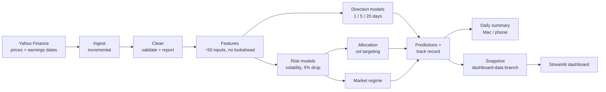

# Stock Market Predictor

[](https://github.com/Chrish1603/Stock-Market-Predictor/actions/workflows/pipeline.yml)


[](https://chrish-patel-stock-market-predictor.streamlit.app/)

An automated machine-learning system for US stocks that forecasts **risk** (volatility, the chance of a 5% drop,
the market regime), sizes positions with **volatility targeting**, and tests every claim it makes with
out-of-sample statistics. It runs itself every trading day, keeps a public track record, and sends a short summary.

**[Open the live dashboard →](https://chrish-patel-stock-market-predictor.streamlit.app/)** (updated each US trading day)

<picture>
  <source media="(prefers-color-scheme: dark)" srcset="docs/images/today-dark.png">
  
</picture>

## Findings

All out of sample. Every claim is tested with confidence intervals; see [docs/RESULTS.md](docs/RESULTS.md).

- **Risk is predictable.** Volatility forecasts beat both "same as last month" (R² +0.31) and the standard HAR
  model (+0.05), p < 0.001. For the S&P 500 they explain 42% of the variation in 5-day volatility, and the edge
  holds over 1997–2026 too (better than both in 15 of 16 periods). Earnings dates
  measurably help (p = 0.03), and drop probabilities beat the historical rate, slightly (p = 0.02).
- **Direction is barely predictable.** The best models beat a coin flip by a statistically clear but tiny margin
  (ROC-AUC 0.52 vs 0.50). No extra input, and pooling 63 stocks into one model, made a detectable difference.
- **Volatility targeting softens sudden crashes, not slow ones.** On a 2013–2026 out-of-sample backtest it cut the
  4-stock portfolio's worst drawdown from −37.5% to −17.8%. Tested on the S&P 500 back to 1997, it cut 2008 from
  −55% to −34% and COVID from −33% to −17%, but the slow 2000–02 decline only from −47% to −42%, because volatility
  stayed moderate while prices fell. Its Sharpe ratio is *not* clearly better than buy-and-hold in either test
  (p = 0.38, p = 0.34): the benefit is a smoother ride, not more return per unit of risk.
- **A better forecast didn't mean better sizing.** Sizing with last month's volatility did as well as sizing with
  the model's forecast, so the simpler rule is the default.

> Educational project, not financial advice.

## How it works



Every weekday after the US close, GitHub Actions runs the whole pipeline, publishes a ~5 MB snapshot to the
`dashboard-data` branch (which the hosted dashboard reads) and carries the track record forward. The same
pipeline runs locally on a schedule. Model comparisons go through `smp experiment`, which reports intervals and
corrected p-values rather than raw averages.

## What I learned

- **Evaluation is the hard part, not modelling.** Most of the work went into closing leaks: overlapping multi-day
  labels (fixed with purged, gapped walk-forward splits), split-adjusted prices changing under stored data, today's
  unfinished price bar, earnings dates "known" too far ahead, and interest-rate levels that let trees memorise eras.
- **When direction failed, risk worked.** After many variations the up/down models stayed near a coin flip, so the
  project pivoted to volatility, which is persistent and genuinely forecastable.
- **Informal comparisons misled me twice.** A higher Sharpe ratio and a better pooled-model hold-out year both
  looked like wins. Proper confidence intervals (bootstrapping whole time periods, Holm correction) showed both
  were noise. That's why every claim above links to a report.
- **Probabilities need calibration.** A gradient-boosted "big drop" model ranked risk well but was overconfident.
  A random-walk formula driven by the volatility forecast, then calibrated, beat it.
- **A better forecast isn't always a better decision.** The model forecasts volatility more accurately than last
  month's figure, yet sizing positions with it was no better.
- **The test period shapes the story.** "Vol targeting halves drawdowns" was true from 2010 on and not before.
  Extending the S&P 500 back to 1993 put two very different bear markets in the test, and only one of them
  matched the claim.

## Quick start

Requires Python 3.10+. On macOS, LightGBM and XGBoost need OpenMP: `brew install libomp`.

```bash
python3 -m venv .venv && source .venv/bin/activate
pip install -e ".[dev]"
smp run-all                      # download, clean, build features, train, predict, summarise (~5 min)
streamlit run app/dashboard.py   # open the dashboard
```

Other commands:

```bash
smp run-all --skip-train         # refresh data and forecasts with the existing models
smp ingest | clean | features | train | sync | predict | notify    # one stage
smp track-record                 # how past live risk forecasts and direction calls turned out
smp experiment run experiments/risk_vol_models.yaml         # compare config variants
smp long-history                 # S&P 500 risk models from 1993, tested through past crashes (~1 min)
smp publish --out site-data      # build the dashboard snapshot
```

Settings live in [config/config.yaml](config/config.yaml): tickers, the 59-stock training universe, horizons,
optional inputs, risk targets, costs, notifications and the snapshot URL. Logs go to `logs/`.

## Dashboard

| Tab | What it shows |
|---|---|
| **Today** | Market regime, and per stock: 3-month trend, volatility forecast vs its own history, chance of a 5% drop vs usual, suggested holding, and a plain-English summary |
| **Risk & allocation** | Risk forecasts for 5 and 20 days, forecast vs realised volatility, the 2013–2026 allocation backtest and the regime history |
| **Price & indicators** | Candlesticks with moving averages and Bollinger band, volume, RSI, MACD |
| **Direction models** | Up/down and return models per horizon: metrics vs baseline, ROC curve, what each model relies on, hold-out backtest |
| **Track record** | Every live forecast and how it turned out: volatility vs last month's figure, drop chances vs the historical rate, direction calls vs always guessing "up" |
| **Data quality** | What the cleaning step fixed or flagged |

| Volatility forecast vs what happened | Volatility targeting vs buy-and-hold |
|---|---|
|  |  |

## Running it automatically

**Locally (macOS):** [scripts/install_schedule.sh](scripts/install_schedule.sh) installs a launchd job that runs
`smp run-all` at 11:00 Tue–Sat local time (just after the US close from New Zealand). Set `HOUR`, `MINUTE` and
`DAYS` for your time zone. If a run fails, you get a desktop notification. Logs go to `~/Library/Logs/smp/`.

```bash
scripts/install_schedule.sh
launchctl kickstart gui/$(id -u)/com.smp.pipeline     # run it once now to check
```

macOS blocks background jobs from reading `~/Documents`, `~/Desktop` and `~/Downloads`. If the project lives
there, either move it (e.g. to `~/Projects`) and rerun the installer, or give `/bin/bash` Full Disk Access in
*System Settings → Privacy & Security*.

**GitHub Actions:** [.github/workflows/pipeline.yml](.github/workflows/pipeline.yml) lints and tests every push.
After each US close (or via *Run workflow*) it runs the pipeline and publishes the dashboard snapshot. GitHub's
scheduler can drop runs, so there are three slots (22:30, 01:30 and 04:30 UTC); later ones exit early once the day
is published. A run fails, and GitHub emails you, if data is still out of date afterwards. The summary appears on
the run page.

**One track record:** the GitHub run keeps the official record, the one the hosted dashboard shows. Each local
run first merges it in (`smp sync`): for days both recorded, the official prediction wins, and anything only the
local record has is kept, so nothing is ever dropped. Turn this off with `dashboard.sync_track_record: false`.

**Health check:** `smp health` lists stale or missing data and exits with an error if there is any. The daily
summary and the dashboard also warn when data is out of date.

**Hosted dashboard (Streamlit Community Cloud):** sign in at [share.streamlit.io](https://share.streamlit.io)
with GitHub, choose *Create app*, pick this repo, branch `main`, file `app/dashboard.py`, Python 3.10, and deploy.
With no local pipeline output, the app downloads the latest snapshot from the `dashboard-data` branch (hourly
cache). `requirements.txt` and `packages.txt` cover the install.

**Daily summary:** written to `logs/summary.md` after every run. Optional delivery:
- Mac notification: `notify.macos: true` in the config (on by default here).
- Phone push via [ntfy](https://ntfy.sh): install the app, subscribe to a hard-to-guess topic name, then set
  `notify.ntfy_topic` locally, and/or add it as an `NTFY_TOPIC` repository secret for the GitHub run. ntfy topics
  are public to anyone who knows the name, so treat the name like a password.

## Results in detail

**Volatility forecasts** (walk-forward CV R² on log annualised realised volatility; higher is better):

| Ticker | Horizon | Chosen model | R² | HAR baseline | "Same as last month" |
|---|---|---|---|---|---|
| SPY | 5d | ridge | **0.42** | 0.26 | 0.09 |
| SPY | 20d | ridge | **0.15** | 0.13 | −0.20 |
| AAPL | 5d | ridge | **0.17** | 0.07 | −0.12 |
| MSFT | 5d | ridge | **0.16** | 0.09 | −0.14 |
| NVDA | 5d | lightgbm | **0.09** | 0.02 | −0.16 |

Single stocks are harder than the index because of earnings jumps. Drop probabilities are chosen by Brier score;
where nothing beats the historical drop rate, the dashboard shows the historical rate.

**Allocation, 2013–2026 out of sample** (15% volatility target, no leverage, 0.1% cost per unit traded):

| 4-stock equal weight | CAGR | Volatility | Sharpe | Max drawdown |
|---|---|---|---|---|
| Buy & hold | 33.9% | 24.5% | 1.31 | −37.5% |
| Vol target, trailing vol (default) | 18.5% | 12.8% | 1.40 | **−17.8%** |
| Vol target, model forecast | 17.7% | 13.3% | 1.29 | −22.8% |
| Model forecast + drop filter | 16.4% | 12.6% | 1.27 | −22.6% |

Vol targeting holds about a third in cash on average, so it gives up return in a strong bull market in exchange
for half the drawdown. This period was unusually good for these four stocks, which flatters buy-and-hold.

**Through past crashes** (S&P 500 only, data from 1993, out of sample from 1997; return from the index's peak to
its trough; [long_history](experiments/reports/long_history.md)):

| Crisis | Buy & hold | Vol target, trailing vol | Average holding |
|---|---|---|---|
| Dot-com bust, 2000–02 | −46% | −41% | 72% |
| Financial crisis, 2007–09 | −53% | −32% | 62% |
| COVID crash, 2020 | −28% | −16% | 50% |
| 2022 bear market | −23% | −18% | 68% |
| Whole period, 1997–2026: CAGR / max drawdown | 9.6% / −55% | 8.0% / −44% | 85% |

The rebuild uses SPY alone (no cross-sectional ranks or breadth, which need the 2010+ stock universe).

**Market regime** (S&P 500, out of sample; what happened over the next 20 trading days):

| Regime | Share of days | Volatility | Chance of a 5% drop | Average return |
|---|---|---|---|---|
| Calm | 26% | 10% | 8% | +0.6% |
| Normal | 60% | 14% | 13% | +1.0% |
| Stressed | 14% | 24% | 24% | +3.0% |

The labels separate risk well, but returns were higher after stressed days (rebounds): a risk signal, not a sell
signal. Known limitation: the label switches in and out of "stressed" often (73 spells in 13 years, and 128 in
29 years on the long S&P 500 history).

**Direction models:** see [direction_inputs](experiments/reports/direction_inputs.md) and
[direction_scope](experiments/reports/direction_scope.md). Optional inputs (Treasury yields, sector funds) and a
pooled 63-stock model are available in the config but made no detectable difference, so they're off.

## How results are tested

An experiment is a YAML file in [experiments/](experiments/) listing variants as overrides to `config.yaml`:

```yaml
name: direction_inputs
kind: direction                 # direction | risk | allocation
metric: classifier.roc_auc
control: default
compare_models: [baseline]      # also test the chosen model against these
variants:
  default: {}
  plus_rates: {data: {market_tickers: [SPY, ^VIX, ^TNX, ^IRX]}}
```

Each variant trains in its own folder (live models are untouched; unchanged variants are reused). Scores are paired
by stock, horizon and walk-forward period. 95% intervals come from a **cluster bootstrap over time periods**,
because scores from the same period move together; treating them as independent would make intervals far too
narrow. Allocation comparisons use a **block bootstrap** of daily returns. p-values are **Holm-corrected** across
the variants in each experiment, so running many variants doesn't manufacture a winner.

```bash
smp experiment list     # experiments and whether each has a report
smp experiment index    # rebuild docs/RESULTS.md from the reports
```

### Guarding against misleading results

- Features at day *t* only use data up to *t*'s close (`tests/test_features.py::test_no_lookahead`).
- Time-ordered splits only, with a gap between train and test at least as long as the horizon; the rows before the
  hold-out are purged; scaling is fit inside each fold.
- Every model is compared with a naive baseline; backtests charge costs and are compared with buy-and-hold.
- Today's price bar is ignored until 16:30 New York time; stored prices are refetched if splits or dividends
  re-adjust history.
- Earnings dates are only treated as known up to 20 business days ahead, and an earnings surprise only from the
  first trading day that reflects it.
- Live forecasts (risk and direction) are recorded before the outcome exists, only the first per day is kept,
  and they're scored with the same definitions as the training targets.

## Pipeline reference

| Stage | Module | Output |
|---|---|---|
| Ingest | `smp.ingest` | Adjusted daily prices for 64 tickers and earnings dates, fetched incrementally |
| Clean | `smp.clean` | Validated prices plus a quality report (filled values, dropped rows, fixed bars, flagged extreme days) |
| Features | `smp.features` | Price, volatility, market, earnings, cross-sectional rank and calendar inputs; targets per horizon |
| Train | `smp.train`, `smp.pooled` | Direction models (baseline, linear, LightGBM, XGBoost) chosen by walk-forward CV, per stock or pooled |
| Risk | `smp.risk` | Volatility (vs persistence and HAR) and calibrated 5%-drop models, with out-of-fold predictions |
| Allocation | `smp.allocation` | Volatility-targeted sizing and its out-of-sample backtest |
| Regime | `smp.regime` | Calm / normal / stressed label from forecast volatility, breadth and trend |
| Sync | `smp.sync` | Local runs adopt the official track record from the published snapshot |
| Predict | `smp.predict`, `smp.history`, `smp.risk_history` | Latest forecasts and the append-only, auto-scored track records |
| Notify | `smp.notify` | Daily summary to file, GitHub, Mac and phone |
| Publish | `smp.publish` | Dashboard snapshot |
| Experiments | `smp.experiment`, `smp.stats` | Variant comparisons with cluster-bootstrap intervals and Holm correction |

## Project layout

```
config/config.yaml        settings
src/smp/                  pipeline package (one module per stage, plus cli, stats, experiment)
app/dashboard.py          Streamlit dashboard          .streamlit/   theme
experiments/              experiment specs and reports  docs/         results page and images
scripts/                  launchd job and runner        .github/      CI and the daily run
tests/                    pytest suite (pipeline, leakage, statistics, dashboard, experiments)
```

```bash
pytest && ruff check .
```
